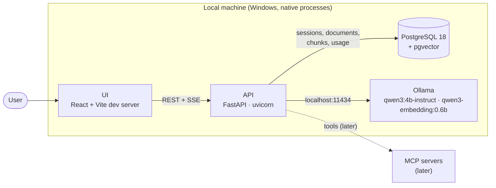
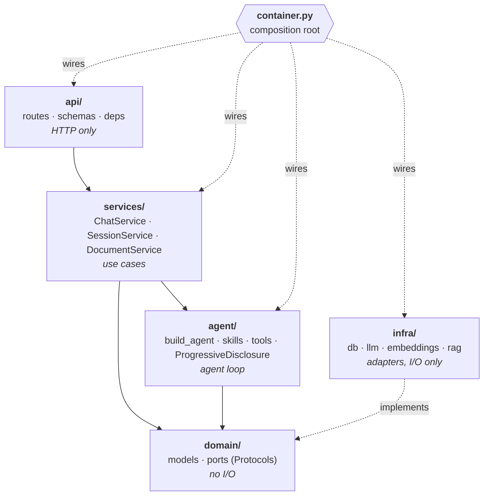
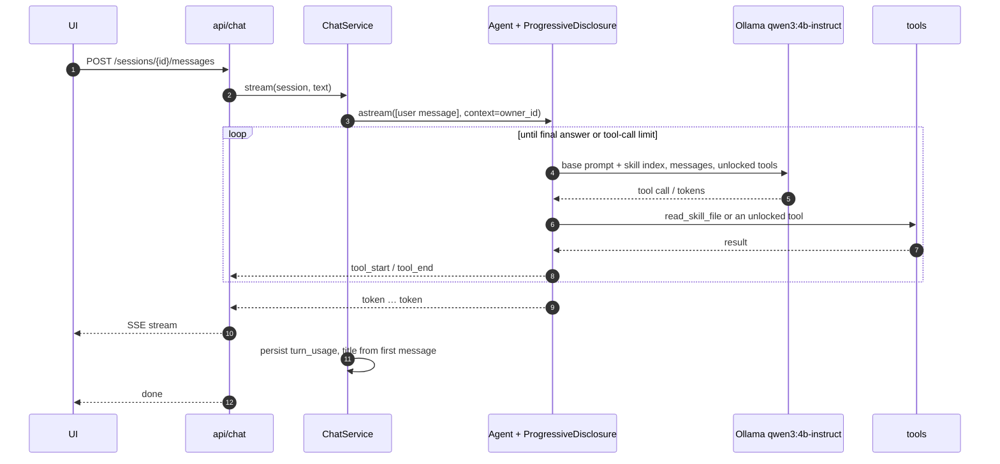
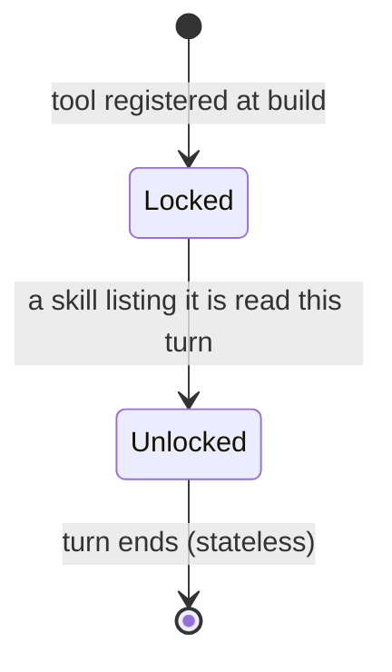
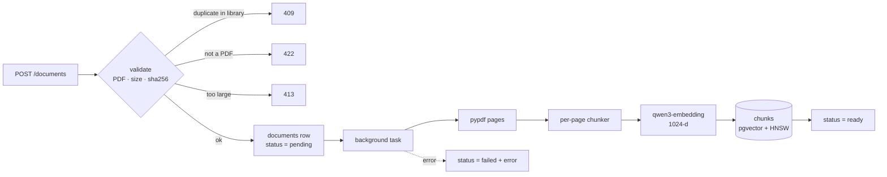
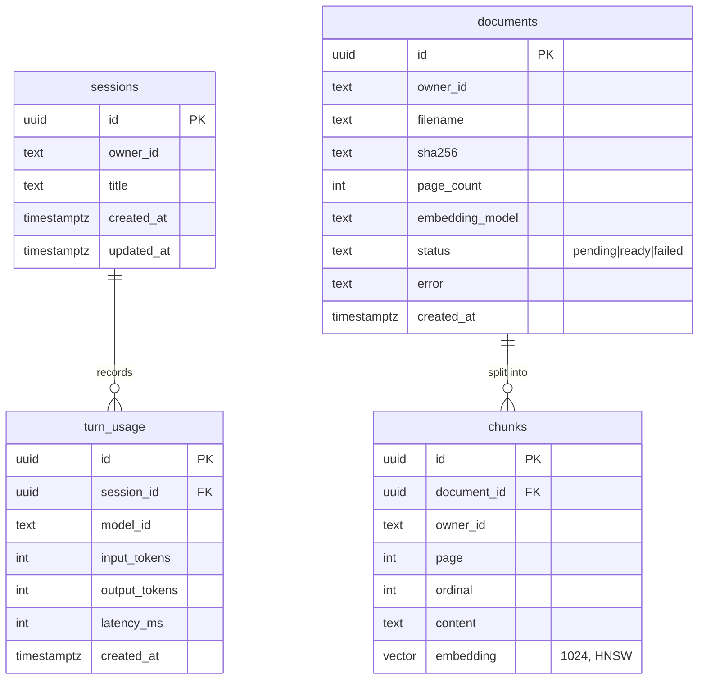

# Architecture

The design and why it is this way. What is implemented right now, file by file, is in [FLOW.md](FLOW.md). Change this file only when the developer approves a design change (see [CLAUDE.md](../CLAUDE.md)).

## TL;DR

- **What:** chat with your PDFs. One agent on Ollama (`qwen3:4b-instruct`) answers from a per-owner document library in Postgres + pgvector and cites pages.
- **Progressive disclosure:** the model starts with a small base system prompt and a one-line index of skills. It reads a skill (`read_skill_file`) before it can use the skill's tools.
- **Layers:** `api → services → domain ← infra`, with `agent` depending only on domain ports. `container.py` is the only module that wires concrete classes.
- **Stateless turns:** each question is answered on its own. No history reaches the model.
- **Library, not workspaces:** PDFs are ingested ahead of time, independent of any chat, and every session searches all of the owner's `ready` documents.

---

## System overview

Everything runs natively; there is no Docker locally. Ollama uses the GPU directly, and Postgres runs as a Windows service with pgvector built from source. CI uses a `pgvector/pgvector:pg18` container.

---

## Layers

| Layer | Owns | Must not |
|---|---|---|
| `api/` | Request parsing, response and SSE shaping, status codes | Contain business rules or touch the DB |
| `services/` | Use cases: chat turn, session CRUD, ingestion, search | Import concrete adapters |
| `agent/` | Agent assembly, middleware, skills, local tools | Import concrete adapters |
| `domain/` | Entities, value objects, ports | Do I/O |
| `infra/` | Postgres, pgvector, Ollama, PDF parsing | Decide anything beyond translating I/O |

| Port (`domain/ports.py`) | Adapter (`infra/`) |
|---|---|
| `ChatModelProvider` | `llm/ollama.py`, selected through `llm/model_factory.py` |
| `Embedder` | `embeddings/ollama.py` |
| `SessionRepository`, `DocumentRepository` (incl. vector search), `UsageRepository` | `db/repositories/*` |
| `UnitOfWork` | `db/unit_of_work.py` |

Ports use `langchain_core` types (`BaseChatModel`, `BaseTool`) directly instead of rewrapping them.

---

## A chat turn

---

## Progressive disclosure

| Layer | Source | The model sees it |
|---|---|---|
| L0 base prompt | `agent/prompts/system.md` | Always, as the start of the system prompt |
| Skill index | frontmatter of every `agent/skills/<name>/SKILL.md` | Always, appended to the base prompt: one line per skill (name, path, description, tools) |
| L1 skill | `agent/skills/<name>/SKILL.md` | After `read_skill_file("<name>/SKILL.md")` returns it as a tool result. Reading it unlocks the tools in its `allowed-tools` |
| Tools | local (`agent/tools.py`), MCP later | Only when unlocked by a read skill |

Locked tools are hidden from the model's tool schema, and a call to one is refused, in case the model names it anyway. Skills and tools are separate: a skill says how and when to use tools, a tool does I/O, and `allowed-tools` connects them by name. The format of a skill is fixed by [skill-template/SKILL.md](skill-template/SKILL.md).

---

## Document ingestion

---

## Data model

`documents` is unique on `(owner_id, sha256)`. `chunks.owner_id` is denormalised so every vector search filters by owner without a join. Sessions and documents are independent: deleting a session leaves the library untouched.

---

## Key decisions

| # | Decision |
| - | -------- |
| D1 | One agent. LangChain `create_agent` runs only the tool loop; sessions, ingestion and streaming are plain services |
| D2 | Ollama only, native on the host. One chat model for everything, so Ollama never swaps models in 6 GB of VRAM |
| D3 | PostgreSQL 18 + pgvector, native; HNSW cosine index; one embedding model per deployment, stored on each document and checked by `/ready` |
| D4 | Progressive disclosure: base prompt + skill index → `SKILL.md` → tools. A tool is unlocked only by a read skill's `allowed-tools` |
| D6 | Stateless single-turn queries. No checkpointer; history is a later enhancement |
| D7 | One document library per owner instead of per-session workspaces (below) |
| D8 | Chunks never cross a page, and retrieval context comes from the same page only, so every citation has one correct page |
| D9 | The owner comes from the server and reaches tools through `AgentContext`, never through tool arguments or the model |
| D10 | Logs carry ids, counts, sizes and durations, never message text, document content or file bytes |

### D7: document library instead of per-session workspaces
- **Context:** PDFs were first scoped to the session they were uploaded in. Everything is local, so ingesting once ahead of time is cheap, and the same PDF was being embedded again for every session.
- **Decision:** documents belong to the owner. `POST /documents` ingests a PDF into the library, and every session searches all of the owner's `ready` documents.
- **Consequences:** no per-session document selection; deleting a session keeps its documents, and `DELETE /documents/{id}` removes one. Migration `0004` moved existing rows to their session's owner and kept the earliest copy of duplicated PDFs. Its downgrade deletes all documents because they can't be mapped back to a session.

---

## Extension points

Planned enhancements and where each plugs in:

| Enhancement | Extension point |
|---|---|
| MCP tools | MCP client tools passed to `build_agent` next to the local ones, unlocked by `allowed-tools` like any tool |
| More skills | A new `agent/skills/<name>/SKILL.md` |
| Follow-ups + history | Postgres checkpointer + summarization middleware in `build_agent` |
| Human approval for tools | Human-in-the-loop middleware (needs the checkpointer) |
| Long-term memory | Memory tools + a skill that lists them + a `memories` table |
| Web search | Search tools + a skill that lists them |
| Agent profiles, auto routing | Routing middleware choosing a model per call (today there is one model) |
| Other chat providers | New provider registered in `ModelFactory` |
| Tracing + evals | Langfuse callback handler; eval datasets |
| Real auth | Replace `DEFAULT_OWNER_ID` with a resolved user in `api/deps.py` |
